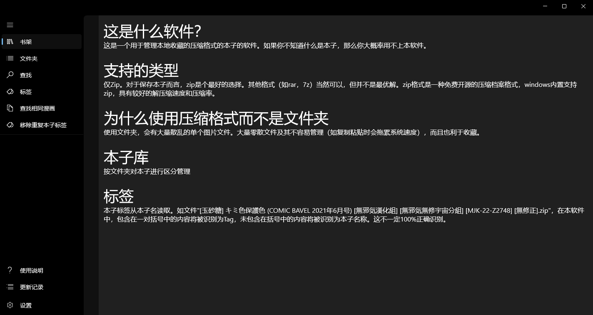
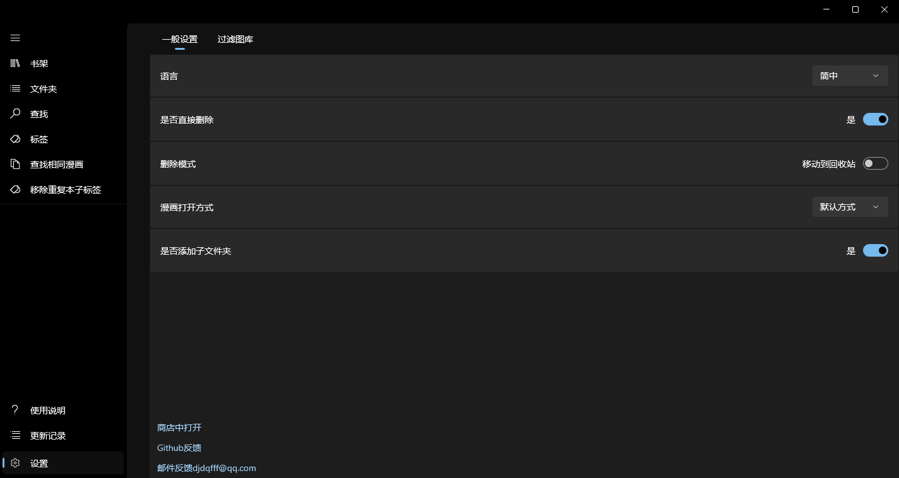
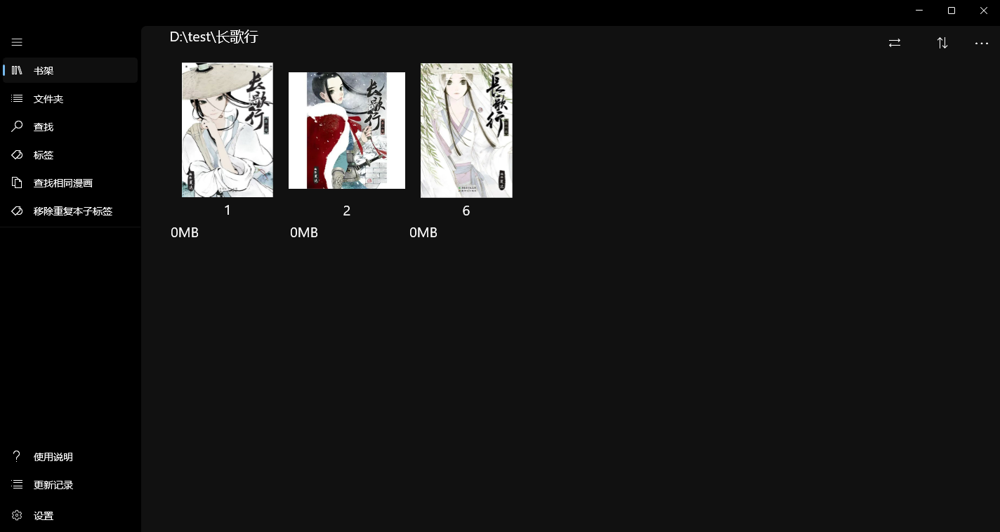
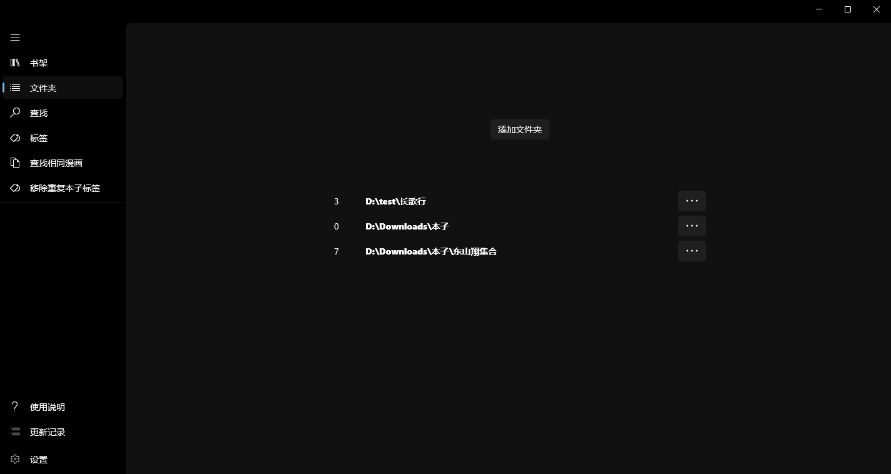

# 本子管理器 / EroMangaManager

## 自用软件，无偿分享。有爱自取，不喜勿喷。

此为UnoPlatform版本。另有WinAppSdk/WinUI3版本、UWP版本和一个UWP/WinUI3版本，皆已存档。

此处截图功能不全，仅用于Microsoft商店发布提交

Microsoft商店可下载：[本子管理器| Microsoft Store](https://apps.microsoft.com/detail/9N7C8ZDQ1TJ8?hl=zh-cn&gl=CN&ocid=pdpshare)

Apk文件为配合本体使用的简单远程（局域网192.168内）使用，在软件内开启服务。
未在安卓商店发布。

